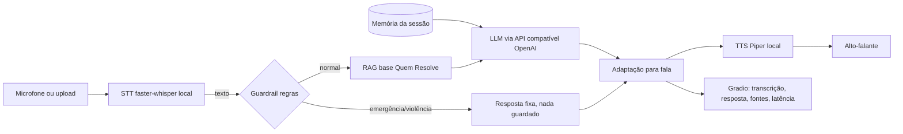

# Quem Resolve? · Assistente de voz (GS 2026.2 · NLP & Chatbots)

Assistente de voz em português que **escuta** o morador de São Paulo, **entende** qual problema ele viu na rua
e **responde falando** quem resolve e como acionar o canal certo, sem precisar digitar.
É o módulo de voz (RF60 a RF67) do produto *Quem Resolve?*, desafio CitizenTech.

**Integrantes:** Matheus Mikio Tutume Lourenço (RM 561864) · Ian Nobres de Azevedo (RM 561861) · Turma 2TIAPY

**Vídeo de demonstração (conversa real por voz):** https://youtu.be/Lbp7k8t4Fzs

> Persona: **Dona Cida, 64 anos, Zona Leste**. Usa WhatsApp, mas trava em sites e formulários.
> ODS 11 (Cidades e comunidades sustentáveis), com apoio dos ODS 10 e 16.

## Arquitetura



Cada etapa é um módulo em `pipelines/voz/` e pode ser trocada sem mexer nas outras:

| Módulo | Arquivo | Função |
|---|---|---|
| STT | `stt.py` | faster-whisper, `language="pt"`, VAD e vocabulário do domínio |
| Guardrail | `guardrail.py` | Regras de emergência e violência (níveis 0 a 3 do PRD), roda antes do LLM e sem internet |
| Base de conhecimento | `rag.py` + `base_conhecimento/` | 21 categorias "quem resolve o quê" + FAQ, busca semântica com fontes |
| LLM | `llm.py` + `prompts.py` | Qualquer endpoint compatível com OpenAI (Groq, Gemini, Ollama) e system prompt com papel, tom e limites |
| Memória | `memoria.py` | Últimos 6 turnos, só em RAM, apagada em "Nova conversa" |
| Adaptação para fala | `adaptacao_fala.py` | Tira markdown, links e emojis; telefones dígito a dígito; siglas, datas e números por extenso |
| TTS | `tts.py` | Piper (local, padrão) ou edge-tts (nuvem) |
| Latência | `latencia.py` | Tempo de cada etapa e total até o início da fala, gravado em `logs/latencia.csv` (sem texto nem áudio) |
| Orquestrador | `assistente.py` | Liga tudo e mede a latência de cada etapa |
| Contrato da API | `contrato.py` | Saída de `POST /voz/conversar` em Pydantic, no formato do `CONTRATOS.md` (seção H); ver `docs/integracao_api.md` |

## Modelos e licenças

| Componente | Modelo / biblioteca | Versão | Licença |
|---|---|---|---|
| STT | Whisper `small` e `medium` via faster-whisper (CTranslate2) | faster-whisper 1.2.1 | MIT (código e pesos) |
| LLM (principal) | gpt-oss-120b (`openai/gpt-oss-120b`) via API Groq, `reasoning_effort=low` | — | Apache 2.0 + termos da Groq |
| LLM (comparação) | gpt-oss-20b (`openai/gpt-oss-20b`) via Groq | — | Apache 2.0 |
| LLM (opção local) | Qwen2.5 7B Instruct via Ollama | `qwen2.5:7b` | Apache 2.0 |
| Embeddings | `paraphrase-multilingual-MiniLM-L12-v2` (sentence-transformers) | sentence-transformers ≥ 3.0 | Apache 2.0 |
| TTS (principal) | Piper, voz `pt_BR-faber-medium` | piper-tts 1.8.0 | piper-tts: GPL-3.0-or-later; voz: repositório MIT, dataset CC0 (MODEL_CARD de `rhasspy/piper-voices`) |
| TTS (comparação) | edge-tts, voz `pt-BR-FranciscaNeural` | edge-tts 7.3.1 | edge-tts: LGPL-3.0; o serviço de voz é da Microsoft |
| Interface | Gradio | 5.50.0 | Apache 2.0 |
| Métricas | jiwer | 4.0.0 | Apache 2.0 |
| Números por extenso | num2words | 0.5.14 | LGPL |

Versões testadas em novembro de 2026. A Groq descontinua modelos com frequência (o Llama 3.3 70B e o Llama 3.1 8B foram desligados em 16/08/2026); a lista atual está em https://console.groq.com/docs/models. Se um modelo sair do ar, o assistente mostra um erro claro e basta trocar `LLM_MODELO`.

## Como executar

### Máquina local (ambiente usado nos testes)
Todos os resultados do relatório foram medidos numa máquina local comum, **sem aceleração por GPU**:
AMD Ryzen 7 3800X (8 núcleos, 16 threads), 16 GB de RAM, Windows 11 Pro, Python 3.11.0.
STT, embeddings e TTS rodaram em CPU (Whisper com `compute_type=int8`); só o LLM roda na nuvem (Groq).

```bash
python -m venv .venv && source .venv/bin/activate   # Windows: .venv\Scripts\activate
pip install -r requirements.txt
cp .env.example .env        # coloque a chave do LLM
python app_gradio.py        # abre em http://127.0.0.1:7860
```
No Windows, defina `PYTHONUTF8=1` (`set PYTHONUTF8=1` no cmd) para evitar erro de acentuação no console.
Na primeira execução são baixados o Whisper `small` (cerca de 480 MB), o modelo de embeddings (cerca de 470 MB) e a voz do Piper (cerca de 60 MB), perto de 1 GB no total. O Whisper `medium` acrescenta cerca de 1,5 GB.
Em CPU, use `STT_MODELO=base` ou `small`. Para rodar 100% offline, configure o Ollama no `.env`.
Se a máquina tiver placa NVIDIA mas não tiver as bibliotecas do CUDA 12 (erro `cublas64_12.dll is not found`), use `STT_DEVICE=cpu` no `.env`.

### Google Colab (alternativa com GPU T4)
Abra `notebook_colab.ipynb`, ative a GPU T4, envie o zip do projeto, coloque a chave da Groq em **Secrets** com o nome `LLM_API_KEY` e rode as células em ordem.
A interface abre num link `*.gradio.live`. Com GPU, o STT e o TTS ficam mais rápidos do que os tempos em CPU registrados no relatório.

## Testes e métricas

| Teste | Comando | Saída em `testes/resultados/` |
|---|---|---|
| STT: WER em 20 áudios (3 vozes, 5 com ruído) e comparação small × medium | `python testes/avaliar_stt.py --modelos small medium` | `stt_resumo.csv`, `stt_vies.csv`, `stt_detalhado.csv` |
| LLM: 30 perguntas (20 diretas, 5 continuações, 5 fora do escopo) | `python testes/avaliar_llm.py --modelos openai/gpt-oss-20b openai/gpt-oss-120b --juiz openai/gpt-oss-120b` | `llm_<modelo>.csv`, `llm_resumo.csv` |
| TTS: 10 respostas, notas de 3 pessoas | `python testes/avaliar_tts.py gerar` gera um formulário HTML cego para os avaliadores; após as notas, `... resumir` | `testes/tts/formulario_avaliacao.html`, `tts_resumo.csv` |
| Ponta a ponta: 10 conversas × 3 turnos (fala do cidadão sintética quando não há gravação) | `python testes/avaliar_e2e.py` | `e2e_resumo.csv`, `e2e_detalhado.csv` |
| Calibração do limiar do RAG | `python testes/calibrar_rag.py` | `rag_scores.csv`, `rag_calibracao.csv` |
| Testes automatizados do guardrail, da adaptação para fala, do LLM e do fluxo (102 casos) | `pytest testes/unitarios -q` | saída no terminal |

Material de teste: `testes/stt/manifesto.csv` e `testes/stt/ROTEIRO_POR_PESSOA.md` (frases e falantes), `testes/llm/perguntas.csv` (perguntas e respostas esperadas),
`testes/tts/frases_tts.csv`, `testes/e2e/conversas.csv` (roteiro das conversas). Os áudios gravados ficam nas pastas `audios/`.

A correção do LLM tem três camadas: palavras-chave, um LLM juiz que compara com a resposta esperada e a revisão humana, que sempre prevalece. O script lista só as perguntas em que as duas primeiras discordam. Perguntas que disparam o guardrail nível 1 ou 2 (respondidas com texto fixo, sem LLM) são contadas à parte, para não inflar o acerto do LLM.

## Ética e LGPD (resumo)
- **Base legal:** consentimento do titular (LGPD, art. 7º, I). A voz é tratada como dado pessoal sensível, por poder identificar a pessoa (art. 5º, II, e art. 11).
- **Consentimento** na tela inicial, antes do primeiro uso, em texto e em áudio (botão "Ouvir o aviso"), explicando o que é gravado, para onde vai e como pedir exclusão. O aceite é verificado no servidor, as funções não ficam expostas como API e o link público pode ter senha (`APP_USUARIO` e `APP_SENHA`).
- **Retenção mínima:** o áudio é apagado logo após a transcrição; a conversa vive só na memória da sessão; o log guarda só tempos.
- **STT e TTS locais:** a voz nunca sai da máquina. Só o **texto** vai para a API do LLM, processado nos Estados Unidos (transferência internacional, LGPD art. 33), e o usuário é avisado. Se o TTS for trocado para o edge-tts, a tela de consentimento passa a avisar que o texto da resposta vai para a Microsoft.
- **Limites:** recusa assuntos fora de zeladoria; saúde, jurídico e emergência são encaminhados ao canal competente.
- **Guardrail antes do LLM:** emergência (nível 1) e violência (nível 2) recebem resposta fixa e nada é guardado; em violência doméstica a resposta **não é falada em voz alta**. As regras têm 32 casos de teste automatizados, incluindo frases comuns que não podem disparar alarme.
- **Alucinação:** o LLM só usa a base recuperada e diz que não sabe quando não há fonte; a interface mostra as fontes.
- **Sem clonagem de voz:** só vozes sintéticas prontas.

## Estrutura
```
quem-resolve-voz/
├── app_gradio.py            interface
├── notebook_colab.ipynb     execução no Colab
├── pipelines/voz/           módulos do assistente
├── base_conhecimento/       quem_resolve.json + faq.md (com fontes)
├── testes/                  scripts, perguntas, roteiros, áudios e resultados
├── relatorio/               rascunho do relatório e termo de consentimento
└── docs/arquitetura.mermaid
```
