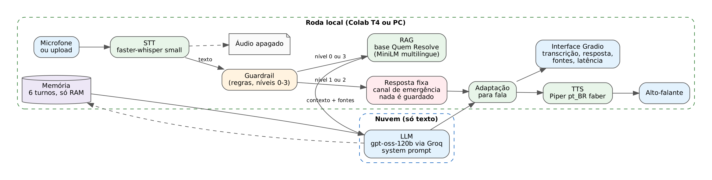

# Quem Resolve? · Assistente de voz para zeladoria urbana
**Global Solution 2026.2 · NLP & Chatbots · Desafio CitizenTech**\
Integrantes: Matheus Mikio Tutume Lourenço (RM 561864) · Ian Nobres de Azevedo (RM 561861) · Turma 2TIAPY · Repositório: https://github.com/GS-Citizen-Tech/GS-PLN-CITIZENTECH · Vídeo: https://youtu.be/Lbp7k8t4Fzs

---

## 1. Problema e persona

Em São Paulo, quem encontra um problema no espaço público (buraco, fio caído, vazamento, lixo acumulado, bueiro entupido)
não sabe a quem recorrer. A responsabilidade se divide entre Prefeitura e subprefeituras, CET, Enel, Sabesp, Comgás,
operadoras de telecomunicação e até proprietários de imóveis. O resultado é desistência, reclamação no lugar errado e
retrabalho de triagem. A Câmara Municipal projetou para o SP156 cerca de 1,08 milhão de solicitações em 2019, distribuídas em
cerca de duzentas categorias de assunto (Machado, 2019).

O mesmo boletim mostra que, no primeiro semestre de 2019, a central telefônica ainda respondia por 48% das solicitações,
contra 36,4% do portal online e 8,3% do aplicativo. Falar continua sendo o jeito preferido de pedir um serviço público.

Para quem tem dificuldade com interfaces de texto, a barreira é maior. Por isso o *Quem Resolve?* tem uma porta de entrada
por voz: o cidadão fala o problema e ouve quem resolve e como acionar o canal certo.

**Persona: Dona Cida, 64 anos, moradora da Zona Leste.** Usa o WhatsApp todo dia, principalmente por áudio, mas trava em sites
e formulários e tem dificuldade para ler letras pequenas. Viu um fio pendurado na frente da casa da vizinha e não sabe se
liga para a Enel, para a Prefeitura ou para a Polícia. Precisa de algo que funcione como uma conversa, com respostas curtas
e números falados de um jeito que dê para anotar.

**Problema resolvido:** reduzir para menos de um minuto, sem digitação, o caminho entre "vi um problema na rua" e
"sei quem resolve e qual número ligar".

## 2. ODS relacionados

- **ODS 11, Cidades e comunidades sustentáveis:** facilita a manutenção do espaço urbano e a participação do morador na gestão da cidade.
- **ODS 10, Redução das desigualdades:** a voz inclui pessoas idosas, com baixa alfabetização ou com deficiência visual ou motora.
- **ODS 16, Instituições eficazes:** o pedido chega ao órgão certo na primeira tentativa, reduzindo retrabalho no serviço público.

## 3. Arquitetura

*Figura 1: arquitetura do assistente. Em verde, o que roda local; em azul, o que vai para a nuvem (só texto).*

O fluxo se repete a cada turno: **microfone → STT → guardrail → RAG → LLM → adaptação para fala → TTS → alto-falante**.
Cada etapa é um módulo Python separado em `pipelines/voz/`, com interface simples (`transcrever`, `buscar`, `responder`,
`sintetizar`), de modo que trocar o Whisper por outro STT ou a Groq por um modelo local é uma mudança de configuração.

| Etapa | Escolha | Onde roda |
|---|---|---|
| Captura | Gradio: botão de microfone ("apertar para falar") e upload de arquivo | Navegador |
| STT | faster-whisper `small`, `language="pt"`, VAD, vocabulário do domínio no `initial_prompt` | Local (CPU nos testes; usa GPU se houver) |
| Guardrail | Regras em português para emergência, violência e zeladoria com risco | Local |
| Base de conhecimento | RAG: 21 categorias + 7 seções de FAQ, embeddings `paraphrase-multilingual-MiniLM-L12-v2`, top 3, limiar 0,40 | Local |
| LLM | gpt-oss-120b via Groq (API compatível com OpenAI), temperatura 0,2, raciocínio baixo | Nuvem |
| Memória | Últimos 6 turnos em RAM | Local |
| Adaptação para fala | Regras com `num2words` | Local |
| TTS | Piper, voz `pt_BR-faber-medium` | Local |
| Interface | Gradio com transcrição, resposta em texto, fontes e latência | Local (http://127.0.0.1:7860) ou link do Colab |

**Ambiente de teste.** Todas as medições deste relatório foram feitas numa máquina local comum, como permite o enunciado,
**sem aceleração por GPU**: AMD Ryzen 7 3800X (8 núcleos, 16 threads), 16 GB de RAM, Windows 11 Pro, Python 3.11.0.
STT (Whisper em `int8`), embeddings e TTS rodaram em CPU; só o LLM roda na nuvem (Groq). Por isso as latências de STT e TTS
abaixo são de CPU: numa GPU (por exemplo, a T4 do Colab, para a qual o projeto também tem um notebook) elas seriam menores.

### 3.1 System prompt
Define três coisas. **Papel:** assistente de voz da cidade de São Paulo que diz quem resolve problemas de zeladoria.
**Tom:** acolhedor, linguagem simples, no máximo três frases, sem markdown, pensando em quem ouve e não em quem lê.
**Limites:** usar só a base recuperada, nunca inventar telefone ou lei, dizer que não sabe e indicar o SP156 quando faltar
informação, recusar assuntos fora do tema e encaminhar saúde (UBS, SAMU 192), jurídico (advogado, Defensoria) e emergência.

### 3.2 Memória e perguntas de continuação
O histórico (pergunta e resposta) dos últimos seis turnos vai para o LLM a cada chamada. O contexto recuperado da base entra
numa mensagem separada e **não** é gravado no histórico, para a conversa não crescer a cada turno. A busca também usa a
pergunta anterior: em "e qual é o telefone deles?", o RAG procura pela pergunta atual somada à anterior ("está vazando água
na calçada"), o que traz a Sabesp mesmo sem a palavra aparecer na continuação.

### 3.3 Adaptação para fala
Antes do TTS a resposta passa por regras que: removem markdown, links e emojis; leem telefones dígito a dígito, com "meia"
para o seis ("zero oitocentos, sete dois, sete dois, um nove meia"); leem números de serviço como as pessoas falam
("um nove dois"); convertem siglas ("CET" vira "cê é tê"), datas ("19/11" vira "dezenove de novembro"), horas, valores e
porcentagens; e quebram frases longas. A tela mostra a resposta original; o áudio usa a versão adaptada.

## 4. Justificativa das escolhas

### 4.1 Nuvem ou local: arquitetura híbrida
| Critério | STT e TTS locais | LLM na nuvem (Groq) |
|---|---|---|
| Privacidade | A voz, dado pessoal e potencialmente biométrico, nunca sai da máquina | Só o texto da pergunta sai, depois do guardrail, e o usuário é avisado |
| Custo | Zero (modelos abertos) | Zero no free tier do protótipo |
| Latência | Modelos pequenos, sem ida e volta pela rede | Inferência em hardware dedicado da Groq; os tempos medidos estão na seção 5.4 |
| Qualidade | Avaliada pelo WER (5.1) e pelas notas do TTS (5.3) | Permite usar um modelo de 120B, muito maior do que os que rodam numa máquina comum ou numa GPU T4; a comparação 20B × 120B (5.2) mostra se o ganho compensa |
| Internet | Funciona offline | Exige internet; se a API falhar, o assistente fala uma mensagem segura indicando o SP156, e o Ollama local é a alternativa |

### 4.2 Base de conhecimento: por que RAG
- **Contexto fixo no prompt** funcionaria hoje (a base tem 28 documentos), mas não escala para a Carta de Serviços do SP156
  coletada pelo robô de RPA, aumenta o custo e a latência de cada turno e dificulta citar a fonte certa.
- **Fine-tuning** foi descartado: telefones e responsabilidades mudam, e um modelo treinado "decora" informação velha sem
  mostrar de onde ela veio. Também exigiria um conjunto de treino que não temos.
- **RAG** permite atualizar a base editando um JSON, mostra as fontes na tela e é o mesmo componente usado na disciplina de
  Generative AI. O chunking é **um documento por categoria**, porque cada categoria já é uma unidade completa
  (problema, responsável, canal, segurança e fonte).

Os telefones das concessionárias foram conferidos em novembro de 2026: os da Enel no plano de comunicação publicado
pela empresa (agosto de 2026), o 0800 da Comgás no manual oficial da empresa e os canais da Sabesp em comunicados de 2026
reproduzidos pela imprensa. As linhas da Prefeitura continuam marcadas como `"validado": false` em `quem_resolve.json`,
porque dependem da Carta de Serviços do SP156.

### 4.3 Comparação entre duas opções: Whisper small × medium
Fonte: `testes/resultados/stt_resumo.csv` (20 áudios, CPU, `int8`, duração média dos áudios de 3,91 s).

| Modelo | WER geral | WER sem ruído | WER com ruído | Tempo médio por áudio | RTF |
|---|---|---|---|---|---|
| small | 5,52% | 2,24% | 14,89% | 2,35 s | 0,63 |
| medium | 2,76% | 1,49% | 6,38% | 6,13 s | 1,63 |

**Decisão:** Em qualidade, o medium é claramente melhor: o WER geral cai pela metade (2,76% contra 5,52%), e o ganho é ainda maior nos áudios com ruído (6,38% contra 14,89%). Sem ruído, a diferença é pequena (1,49% contra 2,24%). No entanto, em CPU, o medium é 2,6 vezes mais lento (6,13 s contra 2,35 s por áudio) e tem RTF de 1,63 — ou seja, leva mais tempo para transcrever do que o próprio áudio dura. O small tem RTF de 0,63. Para a meta de 6 s por turno, só o STT do medium (6,13 s) já esgota o orçamento inteiro antes de o LLM e o TTS sequer começarem; com o small, o turno completo fica em 3,03 s. Por isso o small foi escolhido: em CPU, é a única opção que mantém a conversa fluida. O medium só compensaria com GPU ou se o uso principal fosse em ambiente barulhento.

Também foram comparados os LLMs gpt-oss-20b × gpt-oss-120b (seção 5.2) e os TTS Piper × edge-tts (seção 5.3).

**Dependência de modelos na nuvem.** Durante o projeto, a Groq desligou os modelos Llama 3.3 70B e Llama 3.1 8B
(16/08/2026), que eram a primeira escolha. A troca para o gpt-oss exigiu só mudar uma variável de ambiente, o que
confirma o valor da arquitetura modular. Para não falhar em silêncio, o assistente mostra um erro claro quando o
modelo configurado não existe mais.

### 4.4 Calibração do limiar do RAG
O limiar de similaridade decide se um trecho da base entra no prompt. Ele foi calibrado com as 30 perguntas de teste
(`testes/calibrar_rag.py`): para cada valor entre 0,20 e 0,60, mediu-se a cobertura (perguntas do tema que recuperam algum
documento) e o vazamento (perguntas fora do escopo que recuperam algum documento). Foi escolhido o maior limiar com
cobertura de pelo menos 95%.

| Limiar | Cobertura no tema | Vazamento fora do escopo |
|---|---|---|
| 0,20 a 0,35 | 100,00% | 40,00% |
| **0,40** | **100,00%** | **20,00%** |
| 0,45 | 92,00% | 20,00% |
| 0,50 | 80,00% | 0,00% |
| 0,55 | 56,00% | 0,00% |
| 0,60 | 32,00% | 0,00% |

Limiar adotado: 0,40 (o valor inicial era 0,35). Com 0,40 a cobertura no tema continua em 100% e o vazamento fora do
escopo cai de 40% para 20% (fonte: `testes/resultados/rag_calibracao.csv`).
O limiar só evita contexto irrelevante; quem recusa perguntas fora do tema é o system prompt.

## 5. Resultados

### 5.1 STT (20 áudios, 3 vozes, 5 com ruído)
WER calculado com `jiwer`, após normalização (minúsculas, sem pontuação, números por extenso). Valores agregados sobre o corpus.
Ruído de fundo nos áudios 16 a 20: trânsito e barulho de rua.

| Modelo | WER geral | WER sem ruído (15 áudios) | WER com ruído (5 áudios) | Tempo médio por áudio (CPU) | RTF |
|---|---|---|---|---|---|
| small | 5,52% | 2,24% | 14,89% | 2,35 s | 0,63 |
| medium | 2,76% | 1,49% | 6,38% | 6,13 s | 1,63 |

Piores transcrições (fonte: `stt_detalhado.csv`):

| Áudio | Modelo | Referência | Transcrição | WER |
|---|---|---|---|---|
| stt_17 (B, ruído) | small | Minha rua está alagando com a chuva | Minha rua está lá dentro do nosso clínico. | 71,43% |
| stt_17 (B, ruído) | medium | Minha rua está alagando com a chuva | Minha rua está ladrando com as pinzas. | 42,86% |
| stt_04 (A) | small e medium | Tem um cabo de internet pendurado na calçada | Tem um cabo de internet pendurado aqui na calçada. | 12,50% |
| stt_18 (C, ruído) | small | Tem muito saco de lixo acumulado na esquina | Tem muito saco de lixo acubulado na esquina. | 12,50% |

### 5.2 LLM (30 perguntas)
| Modelo | Acerto no tema (23) | Acerto em continuações (5) | Recusas adequadas (5) | Recusas indevidas | Latência média |
|---|---|---|---|---|---|
| gpt-oss-20b | 82,61% | 80,00% | 100,00% | 0 | 2,84 s |
| gpt-oss-120b | 82,61% | 80,00% | 100,00% | 0 | 4,46 s |

Fonte: `testes/resultados/llm_resumo.csv`. "No tema" são as 25 perguntas do tema menos as 2 respondidas pelo guardrail
(8 e 20), ou seja, 23 perguntas, contando as 5 continuações. A latência é a da chamada completa (RAG + LLM) medida nesta máquina.

Critério: resposta correta quando indica o responsável e o canal esperados (planilha `llm_<modelo>.csv`, com revisão manual
de 1 resposta). Recusa adequada quando o assistente recusa e, em saúde e jurídico, indica o canal competente.
A correção tem três camadas: palavras-chave, um LLM juiz (gpt-oss-120b, temperatura 0) que compara a resposta obtida com a
esperada e a revisão humana, que prevalece. Só as perguntas em que palavras-chave e juiz discordaram foram revisadas à mão
(1 pergunta, a 17 do gpt-oss-120b; concordância entre palavras-chave e juiz de 100,00% no 20b e 96,67% no 120b). Como o juiz é do mesmo provedor e da mesma família do modelo avaliado, ele pode
favorecer as respostas desse modelo; por isso a decisão final nas divergências foi humana.
Nas perguntas que disparam o nível 3 (3, 19 e 25), a correção usa só o texto gerado pelo LLM, sem o aviso fixo do guardrail
que vem antes dele, porque esse aviso sozinho já contém as palavras-chave esperadas.

As perguntas que disparam o guardrail nível 1 (cheiro de gás e furto de fios acontecendo) são respondidas com texto fixo,
sem passar pelo LLM. Por isso ficam fora da tabela acima e são relatadas separadamente:

| Respondidas pelo guardrail | Perguntas | Resposta com o canal correto |
|---|---|---|
| Nível 1 | 8, 20 | 2 de 2 |

Só a pergunta 17 (120b) ficou em dúvida. As palavras-chave marcaram sim, e o juiz marcou não. A pergunta era “A lixeira da praça está quebrada.”, e a resposta esperada era “Prefeitura; SP156”. O modelo respondeu que não sabia quem cuidava disso, mas que dava para pedir limpeza ou reparo pelo SP156, ligando para 156. Na revisão humana, a resposta passou, mesmo sem citar a Prefeitura, porque mostra o caminho certo. Com isso, os dois modelos acertaram 19 de 23 no tema, ou seja, 82,61%.

Os dois erraram as mesmas perguntas: 3, 7, 19 e 25.

3, 19 e 25: fio caído soltando faísca, alagamento e poste com fio solto. Esses casos acionam o guardrail de nível 3, e o aviso fixo, que aparece antes da resposta do LLM, já traz o número certo (Enel ou Defesa Civil). Só que o texto do LLM, que é a única parte corrigida, diz “não sei” e manda para o SP156. É uma falha de integração entre guardrail e LLM: o aviso fixo dá a informação certa, mas o LLM a contradiz logo em seguida e confunde o cidadão. Uma melhoria possível seria, quando o guardrail dispara o nível 3, instruir o LLM a complementar o aviso em vez de respondê-lo de forma independente.
7: esgoto a céu aberto. Os dois modelos disseram não saber e indicaram o SP156, sem citar a Sabesp. É uma falha da busca do RAG, não da base: a categoria “Esgoto na rua” existe, mas o RAG trouxe “Calçada quebrada” como primeiro documento (score de 0,49 em rag_scores.csv). Uma melhoria possível seria usar busca híbrida, combinando embeddings com palavras-chave, ou ampliar os exemplos de frases na categoria “Esgoto na rua”.

A acurácia foi igual, mas o 20b foi mais rápido: 2,84 s de média contra 4,46 s, e mediana de 0,95 s contra 4,95 s. No pior caso, o 20b levou 13,02 s e o 120b, 11,45 s. O sistema usa o 120b porque era o maior modelo disponível no provedor e foi definido como padrão antes dos testes. O teste não revelou nenhum ganho de acerto que justifique essa escolha: as duas versões erraram exatamente as mesmas perguntas. Diante disso, o 20b é uma troca razoável — mesma acurácia, latência menor. Mantemos o 120b por ora como opção conservadora, mas reconhecemos que os dados não sustentam a escolha; uma reavaliação com mais perguntas seria necessária para confirmar se há diferença real.

Nenhum modelo recusou perguntas do tema, e os dois recusaram as 5 perguntas fora do escopo.

### 5.3 TTS (10 respostas, 3 avaliadores, escala de 1 a 5)
Os avaliadores receberam um formulário com os 20 áudios (10 de cada motor) em ordem embaralhada e com códigos neutros,
sem saber qual motor gerou cada um (avaliação cega). Cada áudio recebeu duas notas: naturalidade e clareza.
| Motor | Naturalidade | Clareza | Tempo de síntese |
|---|---|---|---|
| Piper faber | 3,97 ± 0,61 | 5,00 ± 0,00 | 0,32 s |
| edge-tts Francisca | 3,00 ± 0,64 | 4,90 ± 0,31 | 2,72 s |

Notas: média ± desvio padrão das 30 avaliações de cada motor (3 avaliadores × 10 áudios), fonte `testes/resultados/tts_resumo.csv`
(notas individuais em `testes/tts/notas/` e `tts_notas_consolidadas.csv`). Tempo de síntese: média das 10 frases, em CPU
(fonte: `testes/resultados/tts_tempos.csv`). O edge-tts depende da rede.

### 5.4 Ponta a ponta (10 conversas, 3 turnos cada)
| Etapa | Média (s) | Mediana (s) | p95 (s) |
|---|---|---|---|
| STT | 2,17 | 2,16 | 2,35 |
| Guardrail | 0,00 | 0,00 | 0,00 |
| RAG | 0,02 | 0,03 | 0,03 |
| LLM | 0,51 | 0,46 | 0,69 |
| Adaptação | 0,00 | 0,00 | 0,00 |
| TTS | 0,33 | 0,38 | 0,54 |
| **Total até o início da fala** | **3,03** | **3,01** | **3,47** |

Fonte: `testes/resultados/e2e_resumo.csv` (30 turnos; STT `small` e TTS Piper em CPU, LLM gpt-oss-120b na Groq). Pior turno: 3,65 s.

A fala do cidadão nas 10 conversas foi gerada por vozes sintéticas, já que o objetivo deste teste é medir a latência do
fluxo completo, e não a qualidade da transcrição, avaliada com vozes humanas na seção 5.1. O script alterna uma voz feminina
(edge-tts Francisca, conversas ímpares) e uma masculina (edge-tts Antonio, conversas pares). Nas conversas 2, 6 e 8 a voz
masculina do edge-tts não respondeu e o script usou o Piper (faber, masculina) no lugar. Turnos com voz humana: 0 de 30.

O total é medido da chegada do áudio até o arquivo de resposta ficar pronto para tocar. Antes da medição, cada modelo roda uma
inferência de aquecimento, porque a primeira inferência (carregamento do modelo) é bem mais lenta e inflaria o primeiro turno de cada sessão.
As etapas locais (STT, RAG, adaptação e TTS) foram medidas em CPU, sem GPU; numa GPU o STT, que é a etapa local mais pesada, seria mais rápido.
Meta do PRD: menos de 6 s. **Atingida.** A média foi de 3,03 s, o p95 ficou em 3,47 s e o pior turno foi de 3,65 s — todos bem abaixo do limite. O gargalo é o STT em CPU, que levou 2,17 s de média, cerca de 72% do tempo total; o LLM respondeu em 0,51 s neste teste. Vale notar que a fala do cidadão nas conversas foi sintética; no vídeo de demonstração, com voz humana real, o turno sobre água levou cerca de 5 s, ainda dentro da meta. Para reduzir ainda mais a latência, as principais alavancas são GPU (que aceleraria o STT, a etapa mais pesada) e streaming (que permitiria começar a tocar a resposta antes de ela estar completa).

### 5.5 Testes automatizados
O guardrail, a adaptação para fala, o cliente do LLM e o orquestrador têm 102 casos de teste automatizados (`pytest testes/unitarios`). Os casos do guardrail
incluem frases comuns que não podem disparar alarme, como "onde fica o pronto-socorro?", "preciso desabafar" e "a calçada
está com uma ferida enorme", que geravam falsos positivos em uma versão anterior das regras, e frases que precisam disparar,
como "o fio caiu", que antes passava sem alerta. Na adaptação para fala, há testes que aplicam a adaptação a todos os
textos da base e conferem que nenhum telefone é quebrado no meio, defeito encontrado numa revisão anterior. Também há testes
do fluxo completo com componentes simulados (áudio apagado, nível 1 sem LLM e sem memória, log sem texto).
Resultado: 102 de 102 passando (`pytest testes/unitarios -q`, nesta máquina).

## 6. Ética, segurança e LGPD

**Base legal e natureza do dado.** O tratamento se apoia no consentimento do titular (LGPD, art. 7º, I). A voz é dado
pessoal e, quando permite identificar a pessoa, é dado pessoal sensível de natureza biométrica (art. 5º, II), o que exige
consentimento específico e destacado (art. 11, I). Por isso o consentimento é pedido numa tela própria, antes do microfone
aparecer, e não escondido em termos de uso. O titular pode desistir fechando a página e pedir exclusão pelo contato informado.

**Consentimento acessível.** Como a persona tem dificuldade de leitura, o aviso também pode ser **ouvido**: o botão "Ouvir o
aviso" toca uma versão falada, gerada pelo próprio TTS. O aceite é feito por um botão, e não por voz, de propósito: aceitar
falando exigiria gravar e transcrever a voz da pessoa antes de ela ter consentido.

**Consentimento verificado no servidor.** O aceite fica registrado na sessão, no servidor, e as funções que recebem áudio
recusam qualquer chamada sem ele (o áudio recebido nesse caso é apagado sem ser processado). As funções não ficam expostas
como API, e o link público do Colab pode ser protegido por usuário e senha, já que fica aberto a qualquer pessoa por até 72 horas.

**Consentimento.** A tela inicial explica, antes do primeiro uso, que a voz é gravada, onde é processada, que o texto vai
para a API do LLM e o que é guardado. Sem marcar o aceite, o microfone não aparece. Quem gravou os áudios de teste assinou
o termo em `relatorio/termo_consentimento_gravacao.md`.

**Retenção mínima.** O arquivo de áudio é apagado logo após a transcrição (o cache do Gradio também é limpo a cada 10 minutos).
O histórico fica só na memória da sessão e some em "Nova conversa". O log de latência guarda apenas tempos, modelo usado e
nível do guardrail, sem texto e sem áudio. A interface orienta a não falar CPF, RG ou telefone.

**Envio para a nuvem.** Só o texto vai para a Groq; a voz nunca sai da máquina. O usuário é informado disso. Se o TTS for
trocado para o edge-tts, a tela de consentimento passa a avisar também que o texto da resposta vai para a Microsoft.
O contrato da Groq proíbe usar entradas e saídas da API para treinar modelos, e a documentação informa que, por padrão,
os dados das requisições de inferência não são retidos (há divergência entre páginas da própria documentação sobre um
prazo de 30 dias, que deve ser conferido em console.groq.com). Como o processamento ocorre nos Estados Unidos, há
transferência internacional de dados (LGPD, art. 33), coberta pelo consentimento específico e destacado do titular
(art. 33, VIII). Esse é mais um motivo para orientar o cidadão a não falar dados pessoais.

**Limites do assistente.** O system prompt manda recusar assuntos fora de zeladoria. Saúde, jurídico e emergência são
encaminhados ao canal competente. O guardrail por regras roda antes do LLM: em risco imediato (gás, fogo, pessoa ferida,
crime acontecendo) e em violência, a resposta é fixa, com o número certo, e nada entra na memória. Em violência doméstica a
resposta aparece só em texto, sem áudio, para não expor a pessoa a quem estiver por perto. A mensagem é neutra em gênero:
indica o 190 para qualquer pessoa em perigo e o 180 como canal adicional para mulheres.

**Alucinação.** O LLM recebe apenas os trechos recuperados, com temperatura 0,2, e é instruído a dizer que não sabe e indicar o
SP156 quando a base não cobre a pergunta. A tela mostra as fontes de cada resposta.

**Clonagem de voz.** Não usamos clonagem; o Piper e o edge-tts usam vozes sintéticas prontas.

**Análise de viés do STT.**
| Falante | Perfil | Áudios | WER small | WER medium |
|---|---|---|---|---|
| A | masculina, 19 anos, paulista | 7 (2 com ruído) | 2,90% | 1,45% |
| B | masculina, 20 anos, paulista | 7 (2 com ruído) | 11,67% | 6,67% |
| C | feminina, 50 anos, paulista | 6 (1 com ruído) | 1,92% | 0,00% |

O falante B teve o pior resultado (11,67% no small), mas quase todo o erro vem de um único áudio com ruído, o stt_17. Com apenas 7 áudios por pessoa, um único áudio ruim distorce bastante a média. A falante C, a única mulher e a mais velha, teve o menor WER (1,92% no small e 0,00% no medium), mas gravou só 1 áudio com ruído, contra 2 de cada um dos outros falantes — a comparação, portanto, não é justa.

O fator que mais pesa no WER é o ruído de fundo, não o perfil da voz: com o small, o WER vai de 2,24% nos áudios limpos para 14,89% nos áudios com ruído. As palavras do domínio — SP156, Sabesp, boca de lobo e entulho — foram transcritas corretamente pelos dois modelos, o que confirma o valor do `initial_prompt` com vocabulário especializado.

Limite do teste: a amostra tem apenas 3 vozes, todas de falantes paulistas e sem idosos acima de 60 anos — justamente o perfil da persona Dona Cida. Com essa amostra não é possível generalizar; um teste mais representativo precisaria de mais falantes, com idades variadas, sotaques de outras regiões e, idealmente, pessoas com alterações de fala.

## 7. Limitações
- Base pequena e parcialmente validada; responsabilidades podem mudar.
- Sem streaming: o áudio da resposta só começa depois de sintetizado por completo.
- Dependência de um provedor de LLM que descontinua modelos com poucas semanas de aviso.
- O teste ponta a ponta usou fala sintética para o cidadão; a latência do STT com vozes reais pode ser um pouco diferente.
- Dependência de internet e dos limites do free tier para o LLM.
- Guardrail por regras pode deixar passar frases não previstas e disparar em frases ambíguas; os testes automatizados reduzem, mas não eliminam, esse risco (a camada LLM do guardrail fica na disciplina de GenAI).
- Poucas vozes no teste de STT; avaliação do TTS com poucos avaliadores.
- Correção automática do LLM por palavras-chave é aproximada e precisa de revisão humana.
- Compatibilidade de navegador: nos testes, o Brave entregava o áudio do microfone completamente mudo (−100 dB), mesmo com o
  microfone funcionando no Windows; no Chrome a gravação funcionou. O app passou a medir o volume de cada gravação e a avisar
  quando ela chega sem som, em vez de responder apenas "não entendi".

## 8. Melhorias futuras
- Streaming de STT, LLM e TTS para começar a falar em menos de 2 s.
- Detecção automática de voz (VAD) para conversa sem botão.
- Base completa a partir do scraping da Carta de Serviços do SP156, com data de validação por item.
- Integração com o app do cidadão (Next.js) via `processar_turno()` na API FastAPI.
- Geração da solicitação pronta para o SP156 ao fim da conversa.
- Testes com idosos reais e com mais sotaques.

## 9. Referências
- Enunciado GS 2027 PLN: Assistente de Voz (FIAP).
- Enel SP, Plano de comunicação de contingências (2026): central de emergência 0800 72 72 196.
- Sabesp, canais de atendimento: 0800 055 0195 e WhatsApp (11) 3388-8000.
- Comgás, Guia do Terceiro (2021): 0800 011 0197, opção de emergência.
- Câmara Municipal de São Paulo, CPI da Fiação; Boletim SP156 (2019).
- Radford et al. (2022), *Robust Speech Recognition via Large-Scale Weak Supervision* (Whisper).
- Reimers e Gurevych (2019), *Sentence-BERT*.
- Lei nº 13.709/2018 (LGPD), arts. 5º, 7º, 11 e 33.
- Machado, F. T. H. F. (2019). *Boletim da Administração Pública: Serviço "SP 156" (1º semestre de 2019)*. Câmara Municipal de São Paulo.
- Groq. *Model deprecations*. console.groq.com/docs/deprecations (consultado em novembro de 2026).
- Rhasspy. *Model card for faber (medium)*, piper-voices. huggingface.co/rhasspy/piper-voices.

---

## Apêndice A: roteiro do vídeo
Vídeo: https://youtu.be/Lbp7k8t4Fzs (gravado no Chrome, com microfone de headset, na máquina descrita na seção 3).

1. **Apresentação:** integrantes, o *Quem Resolve?*, a persona Dona Cida e o ODS 11.
2. **Consentimento:** o botão "Ouvir o aviso" toca o aviso falado; depois, "Concordo e começar".
3. **Conversa real por voz**, com transcrição, resposta em texto, fontes e latência na tela:
   - Turno 1: "Está vazando muita água na calçada da minha rua." → Sabesp, 0800 055 0195, WhatsApp e Defesa Civil 199.
   - Turno 2 (continuação): "Funciona de madrugada também?" → responde sobre a Sabesp sem que ela seja citada na pergunta.
   - Turno 3 (recusa): "Você sabe me passar uma receita de bolo?" → recusa por estar fora do tema.
   - Turno 4 (guardrail nível 1): "Estou sentindo um cheiro forte de gás na rua." → resposta fixa, sem LLM, com a emergência da Comgás e o 193.
4. **Upload de arquivo de áudio:** semáforo apagado → CET, registro pelo SP156.
5. **LGPD, limitações e próximos passos.**
